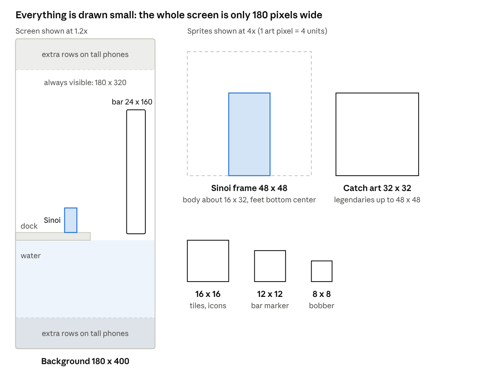

# Illustrator brief

What to draw for Sinoi the Fisherman, at what size, how to animate it and how to deliver it to Godot. Written November 7, 2026; updated November 8 for the fight box and the repository layout.

## The game and the look

A free Android fishing game in Stardew Valley-style pixel art, set in the #HusbandOutWorld world. You draw the fisher Sinoi, the fish, the fishing spots and the interface, at Stardew's scale of 16 x 16 pixel tiles.

**What the player sees.** The phone is held upright (portrait). Each screen is one fishing spot: water, a dock or shore, Sinoi with a rod, and a background that says where we are. When a fish bites, the **fight box** appears: a small square pad at the bottom where the player traces, taps, flicks and holds, with a **shadow copy** of the pad above it showing what their fingers cover. Caught fish pop up as a big icon, go into a bag, and get sold for upgrades. Players travel between spots on a world map.

**First region: Sanbi.** A friendly fishing kingdom on the east coast: docks, a fish-drying factory, the Sanbi Fish Fountain, people who pray to the sea every morning. The canon fish to design first are the **Sanbi** (tuna-like, sheds fake lips and tails as decoys) and, later, the giant **True Sanbi King**.

**Art direction**

- Stardew Valley is the main reference for scale, readability and warmth. Match its feel, not its exact art.
- The series art by Mitsukiven and Feiourm and the world map in the [#HusbandOutWorld repo](https://github.com/Deovandski/HusbandOutWorld) are the reference for the world's colors and landmarks.
- Cozy and readable over detailed: every sprite must read at a glance on a small phone screen.
- Fish are based on real species with lore twists, so real fish photos are fair reference.

**How you'll get templates.** During prototyping, placeholder sprites (often AI-generated) are made at the exact final sizes below. You draw the final art over them, keeping the same canvas, anchor point and animation tags, so your art drops into the game with no code changes.

**What code handles, so you don't draw it:** squash-and-stretch pops, screen shake, fading, sliding menus, simple bobbing, particle sprays, and moving the fight-box targets along their paths.

## Technical specs

Draw everything at true size on a 180 x 320 pixel portrait screen built from 16 x 16 tiles. The game multiplies every pixel by a whole number (6x on a typical 1080-pixel-wide phone), so never draw large and shrink.

- **Base canvas:** 180 wide x 320 tall. On a 1080 x 1920 phone that is exactly 6x.
- **Tall phones:** most phones are taller than 16:9 (for example 1080 x 2400 = 180 x 400 at 6x). The game shows extra sky and water instead of black bars, so **backgrounds are 180 x 400**, with everything important in the middle 320 rows.
- **Pixel rules:** whole pixels only, no blur, no soft brushes, no semi-transparent edges. Each pixel is fully opaque or fully transparent (shadows are a solid darker color).
- **Palette:** one shared palette for the whole game, about 32 to 48 colors, picked or adapted from the [Lospec palette list](https://lospec.com/palette-list) and locked before production art starts.
- **Light direction:** from the top left, everywhere.



Sinoi is only 32 pixels tall on a 400-pixel-tall screen, so every detail has to survive at that size. (The chart's "bar 24 x 160" shows the original Stardew-style bar; the fight box below replaces it.)

**Sizes per asset type** (proposed; confirmed once the prototype runs on phones)

| Asset | Size in pixels | Notes |
| --- | --- | --- |
| Ground and water tiles | 16 x 16 | Water tiles animate in a loop |
| Sinoi body | about 16 x 32 | Stardew's character size |
| Sinoi animation frame (canvas) | 48 x 48 | Room for the rod and line in every frame; feet at the same spot in every frame |
| Fishing rod (separate layer) | fits the 48 x 48 frame | Own layer so better rods swap in without redrawing Sinoi |
| Fish inventory icon | 16 x 16 | Bag, shop and journal lists |
| Fish catch pop-up / journal art | 32 x 32 | Legendaries can go 48 x 48 |
| Fight-box pad frame | about 160 x 160, 9-slice | Interactive pad and shadow pad share the frame; borders 8 px so it can stretch on tablets |
| Fight-box targets | 16 x 16 and 24 x 24 | Tap targets, trace marker, hold zone, spin center; each needs a "hit" and a "miss" frame |
| Fight-box path dots and arrows | 4 x 4 to 8 x 8 | Show where a trace or flick goes |
| Ghost finger dots (shadow pad) | 8 x 8 | Two colors for two fingers |
| Line-tension and catch meters | about 160 x 6 | Frame plus fill |
| Fish marker inside the fight box | 12 x 12 | Must read clearly while moving fast |
| Bobber | 8 x 8 | Plus dip and splash frames |
| Splash, ripple, sparkle effects | 32 x 32 / 16 x 16 / 8 x 8 | Short animations |
| Character portraits (shopkeeper, Winga messenger) | 64 x 64 | Stardew's portrait size |
| UI panels and buttons | 9-slice, e.g. 24 x 24 with 8 px borders | Godot stretches the middle, keeps corners crisp |
| Item icons (bait, tackle, gels) | 16 x 16 | Same grid as fish icons |
| Fishing spot background | 180 x 400, in 3 to 5 layers | Sky, far land, near land, water, foreground |
| World map | 180 x 400 or a larger scrolling image | Can adapt the series world map |

## Asset list for the first playable region

About 60 to 80 sprites and 15 animations. Priority 1 is the smallest set that makes the fishing fight look real on a phone.

| Priority | Asset | Count | Size |
| --- | --- | --- | --- |
| 1 | Sinoi (idle, cast, wait, hook, reel, catch, fail) | 7 animations | 48 x 48 frames |
| 1 | Basic rod | 1 (layer) | in Sinoi's frames |
| 1 | Bobber + dip + splash | 3 small animations | 8 x 8, 32 x 32 |
| 1 | Fight box: pad frame, targets, path dots, ghost fingers, meters, fish marker | about 12 pieces | see specs |
| 1 | Sanbi dock spot background | 1 (3 to 5 layers) | 180 x 400 |
| 1 | Water tiles | 1 set, 4-frame loop | 16 x 16 |
| 1 | Fish: Sanbi + 3 common fish | 4 fish x 3 sizes | 16, 32, 12 px |
| 2 | 8 more Sanbi-region fish | 8 fish x 3 sizes | 16, 32, 12 px |
| 2 | True Sanbi King (legendary) | 1 fish x 3 sizes | 16, 48, 12 px |
| 2 | Fish shadow swimming in the water | 1 animation | 16 x 8 |
| 2 | Rod upgrades | 3 more rods | layer |
| 2 | Bait and tackle icons | 15 or more (see white paper ch. 02) | 16 x 16 |
| 2 | UI kit: panel, buttons, bag slots, coins (Pearl, Amethyst, Aquamarine, Sapphire balls) | about 12 pieces | 9-slice, 16 x 16 |
| 2 | Market / shop screen with shopkeeper portrait | 1 screen + 1 portrait | 180 x 400, 64 x 64 |
| 3 | Winga messenger bird flying in with a notice | 1 animation + portrait | 32 x 32, 64 x 64 |
| 3 | World map with Sanbi and 2 locked spots | 1 | 180 x 400 or larger |
| 3 | Title screen and logo | 1 | 180 x 400 |
| 3 | App icon and store graphics | see below | |

Sinoi's look (race, clothes, colors) isn't designed yet: that is the first design conversation with Deovandski, before any Sinoi animation.

## Animation requirements

Few frames, strong poses: most loops are 4 frames at 6 to 10 frames per second; the cast is the one animation worth extra frames.

| Animation | Frames | Speed | Loops? | Notes |
| --- | --- | --- | --- | --- |
| Sinoi idle | 4 | 6 fps | Yes | Breathing; rod on shoulder |
| Sinoi cast | 6 to 8 | 12 fps | No | Wind-up, whip, release; line and bobber leave in code |
| Sinoi waiting | 4 | 6 fps | Yes | Rod held out over the water |
| Sinoi hook (strike) | 3 | 12 fps | No | Quick jerk upward on the bite |
| Sinoi reeling | 4 | 10 fps | Yes | During the fight; rod bends |
| Sinoi catch | 3 + hold | 10 fps | No | Holds the fish up, Stardew style; fish placed by code |
| Sinoi fail / line snap | 4 | 10 fps | No | Stumble back, disappointed |
| Bobber bob / dip | 4 / 3 | 6 / 12 fps | Yes / No | Dip plays on a bite |
| Splash | 5 to 6 | 12 fps | No | Cast landing and catch |
| Water tiles | 4 to 8 | 6 fps | Yes | Seamless in every frame |
| Fish shadow swimming | 4 | 8 fps | Yes | Dark silhouette under water |
| Fight-box fish marker | 2 to 4 | 8 fps | Yes | Wiggle; code moves it |
| Fight-box target hit / miss | 3 / 3 | 12 fps | No | Pop on success, fizzle on miss |
| Winga flying in | 4 | 10 fps | Yes | Wing flap; code moves it |

**Rules for every animation**

- One Aseprite file per character or object, one **tag** per animation, lowercase: `idle`, `cast`, `wait`, `hook`, `reel`, `catch`, `fail`.
- Same canvas size and the same anchor point (Sinoi's feet, bottom center) in every frame.
- Set frame timing in Aseprite (milliseconds per frame); the importer converts it.
- Keep the rod on its own layer, and anything else that may change with upgrades.

## Software and setup

| Tool | What it's for | Cost | Required? |
| --- | --- | --- | --- |
| Aseprite | Drawing, animating, palettes, tags, sprite sheet export | $19.99 | Yes |
| LibreSprite | Free fork of an older Aseprite, to try before buying | Free | Optional |
| Godot 4.7 | Seeing your art in the game and on a phone | Free | For previewing |
| [Aseprite Wizard](https://github.com/viniciusgerevini/godot-aseprite-wizard) (Godot plugin, MIT) | Imports `.aseprite` animations into Godot, one animation per tag | Free | Added to the project when art starts |
| GitHub Desktop | Getting the latest project and delivering your files | Free | Yes |
| Dedicated test phone in developer mode | Seeing the art at real size and brightness | Paid by the project | Yes |

Aseprite settings: **pixel-perfect** pencil, **onion skin** while animating, a 16 x 16 **grid** for tiles, and the project palette in **Indexed** color mode.

## Export and delivery

Deliver every asset twice: the `.aseprite` source and an exported PNG sprite sheet with its JSON data, at 1x, named in lowercase with underscores.

**File rules**

- **PNG, RGBA, 1x.** Never upscale before export: Godot does the scaling.
- **Sprite sheets:** File > Export Sprite Sheet, **by rows** (one row per tag), equal frame sizes, no trimming, plus **JSON (Array)** data with tag names and frame timings.
- **Tilesets:** one PNG on a strict 16 x 16 grid, no gaps. Water edges need corner and edge pieces; the exact set is agreed later.
- **Backgrounds:** one PNG per layer, all 180 x 400 and aligned.
- **Transparency:** fully transparent or fully opaque pixels only.

**Naming:** `what_name_detail`, lowercase, underscores, no spaces.

- `sinoi.aseprite` → `sinoi.png` + `sinoi.json`
- `fish_sanbi_icon16.png`, `fish_sanbi_big32.png`, `fish_sanbi_marker12.png`
- `bg_sanbi_docks_sky.png`, `bg_sanbi_docks_water.png`
- `tiles_water.png`, `ui_panel.png`, `fightbox_pad.png`, `fightbox_target24.png`

**Folders in the repository**

```
art/source/                 ← .aseprite working files (outside the Godot project)
game/assets/characters/     ← sinoi.png + .json, portraits
game/assets/fish/           ← icons, big art, markers
game/assets/fightbox/       ← pad, targets, paths, meters
game/assets/spots/sanbi/    ← background layers per spot
game/assets/tiles/          ← tilesets
game/assets/ui/             ← panels, buttons, icons, fonts
game/assets/fx/             ← splash, ripple, sparkle
game/assets/store/          ← app icon, store graphics
game/assets/placeholder/    ← AI placeholders; nothing here ships
```

**What Godot does on its side** (already set; listed so you know why art looks the way it does)

- Default texture filter **Nearest**, so pixels stay sharp ([GDQuest](https://www.gdquest.com/library/pixel_art_setup_godot4/)).
- **Integer** scaling (`canvas_items` stretch), so every art pixel becomes an exact block of screen pixels.
- **Lossless** compression, so colors stay exact.

If something looks blurry, doubled or off-color in the game, it's almost always a project setting, not your art: flag it rather than redrawing.

## Android launcher icon and Google Play store graphics

Draw each one small and scale it up by a whole number so pixels stay square.

| Asset | Final size | Draw at | Rules |
| --- | --- | --- | --- |
| Play Store icon | 512 x 512 | 128 x 128, export 4x | 32-bit PNG with alpha, max 1 MB ([Google](https://support.google.com/googleplay/android-developer/answer/1078870)) |
| Feature graphic | 1024 x 500 | 256 x 125, export 4x | JPEG or 24-bit PNG, no transparency |
| Phone screenshots | 1080 x 1920 | captured from the game | At least 2, up to 8; 9:16; no transparency |
| Launcher icon (main) | 192 x 192 | 48 x 48, export 4x | Older Android ([Godot docs](https://docs.godotengine.org/en/stable/tutorials/export/exporting_for_android.html)) |
| Adaptive icon foreground | 432 x 432 | 108 x 108, export 4x | Transparent; keep the important part inside the centered 264 px circle (66 px at 1x) |
| Adaptive icon background | 432 x 432 | 108 x 108, export 4x | Fully opaque |
| Themed (monochrome) icon | 432 x 432 | 108 x 108, export 4x | Optional, Android 13+ |

Upscale with **nearest neighbor** only.

## Learning path

1. **Aseprite basics (a few evenings):** canvas, pixel-perfect pencil, layers, palettes, Indexed mode, timeline, tags, onion skin, Export Sprite Sheet. Start with the [Aseprite docs](https://www.aseprite.org/docs/).
2. **Pixel art fundamentals:** clean lines, clusters instead of noise, avoiding pillow shading, readable silhouettes at 16 x 16, color ramps. Pedro Medeiros' [illustrated tutorials](https://saint11.org/blog/pixel-art-tutorials/) and the [Lospec tutorial library](https://lospec.com/pixel-art-tutorials).
3. **Study Stardew at true size:** how much a 16 x 32 character and a 16 x 16 fish say with few pixels. The [farmer sprite breakdown](https://stardewvalleywiki.com/Modding:Farmer_sprite) shows a character sheet layout.
4. **Low-frame animation:** key poses first, then in-betweens; anticipation before a cast, follow-through after; smears instead of motion blur. Drill: a 4-frame idle, then a 6-frame swing.
5. **Tiles and loops:** a water tile that repeats with no visible seams, animated so every frame still repeats (View > Tiled Mode).
6. **See it in the game:** open the project in Godot, drop a sprite into a test scene, run it on the test phone.

## Trial task

- [ ] **Fish icon:** a real tuna drawn as the "Magatum" at 16 x 16 and 32 x 32, in the chosen palette.
- [ ] **Placeholder fisher:** a simple 16 x 32 figure (not final Sinoi) on a 48 x 48 canvas with a 4-frame `idle` and a 6-frame `cast` tag.
- [ ] **Water tile:** 16 x 16, 4-frame loop, seamless in every frame.
- [ ] **Mini background:** a 180 x 400 dock scene in 3 layers (sky, water, dock).
- [ ] Deliver `.aseprite` + PNG + JSON with the naming above; the result is wired into a test scene and installed on the test phone.

## Open questions

- Sinoi's design: race, age, clothes, colors, personality. Is Sinoi from Sanbi?
- The palette: picked together before production art, or proposed by the illustrator?
- Credit, pay and art ownership (a short written agreement before production work).
- Using the Mitsukiven and Feiourm series art as style reference; are they open to being consulted?
- How much of the books' adult tone shows in the art?
