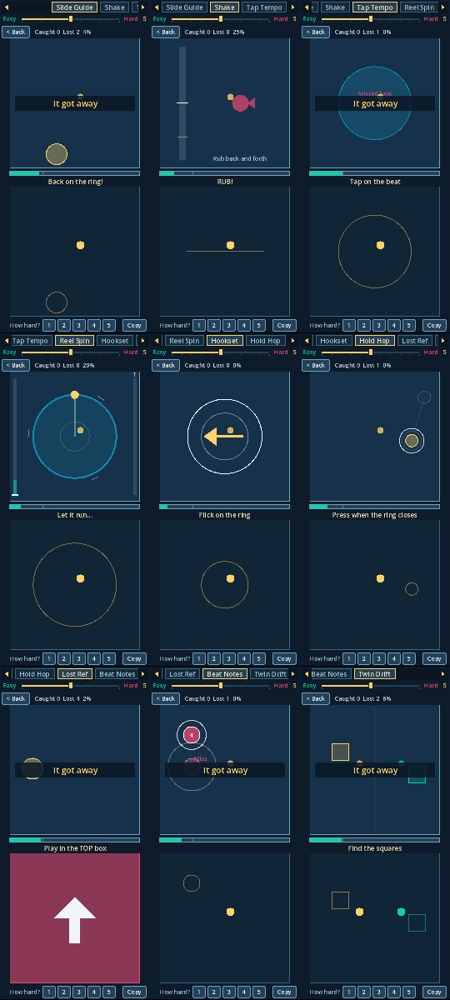

# 04 — Fight-box modes (research and prototypes)

Recorded November 21, 2026 from Deovandski's brief in [issue #1](https://github.com/Deovandski/Sinoi-the-fisherman/issues/1). **Status: prototypes to playtest.** Nothing in this chapter is decided except where marked; the goal is to try the modes on real phones and **rank them from easy to hard**.

## The brief

On the touch-test fight box, add a carousel at the very top to pick between fight-box modes (since replaced by a drop-down, issue #16). Keep the first prototype (now **Slide Guide**) and add:

1. **Press and hold**, lift, then press and hold in a new spot. Tighter spots; the player can't stay outside the spot for long; the touch and the release are punished more than not pressing the exact spot. → **Hold Hop**
2. **Two-finger slides**: index and middle finger each keep a box that moves up, down, left and right in its own area, at varying speed. → **Twin Drift**
3. **Rhythm, closer to osu! / Project Diva**: the player sees the "notes" (taps and drags) ahead of time and matches them. → **Beat Notes**
4. **Fast tapping**: tap faster, slower or in a rhythm; where you tap in the box doesn't matter. → **Tap Tempo**
5. **Flip**: the screen inverts and the player uses the top box instead of the bottom one. → first built as **Flip**, then redesigned by Deovandski as **Lost Ref** (below)
6. **Shake the phone**, falling back to rubbing the screen when there is no accelerometer. → **Shake**
7. Any other modes worth testing. → Claude added **Reel Spin** and **Hookset** (the "spin" and "flick" from the [mechanic vocabulary](02-design-direction.md#mechanic-vocabulary-proposal)).

## How to test

1. Open the game (website or APK) and tap **Fight box: try the modes**.
2. Pick a mode from the drop-down at the top. A card explains the mode; touch the bottom box to start (Shake starts by itself).
3. Set the **difficulty slider** under it: 0 (easy) to 10 (hard), 5 to start. Each mode remembers its own level; moving the slider restarts the fight at the new level.
4. Play a few fish. The meter starts a quarter full: fill it to catch the fish, let it empty and the fish gets away. The row under the slider shows catches, losses, average catch time and accuracy for that mode and level.
5. Tap **Copy** and paste the results to Deovandski. They look like this:

```
Sinoi the Fisherman fight-box test, build 0.0.1, Android, screen 1080x2400, motion sensor yes
mode | difficulty (0-10) | caught | lost | avg catch s | accuracy %
Slide Guide | 5 | 4 | 1 | 7.9 | 81
Slide Guide | 9 | 1 | 3 | 15.0 | 58
Twin Drift | 2 | 1 | 3 | 18.2 | 52
```

Results are kept in the save file per mode and per difficulty level (`playtest.fight_modes`, save format v4, see [SAVE_FORMAT.md](../SAVE_FORMAT.md)), so they add up over several sessions and travel with an exported save. **Reset save** on the title screen clears them. The "How hard?" 1–5 rating boxes were removed (issue #16): the difficulty slider does that job, and catch time, losses and accuracy measure it. The modes, their order and every tuning number live in [`game/data/fight_modes.json`](../../game/data/fight_modes.json), so balancing doesn't need code changes.

## Research: what similar games do

Mechanics only, never names or assets (as decided in chapter 02).

| Game | What it does | What we take |
| --- | --- | --- |
| [osu!](https://osu.ppy.sh/wiki/en/Beatmap/Approach_rate), from the DS game Osu! Tatakae! Ouendan | Circles to tap, sliders to follow, spinners to spin. Notes fade in ahead of time: 1.8 s at AR0 down to 0.45 s at AR10, 1.2 s at AR5. [Hit windows](https://osu.ppy.sh/wiki/en/Beatmap/Overall_difficulty) shrink with Overall Difficulty: 80 − 6×OD ms for a 300, 140 − 8×OD for a 100, 200 − 10×OD for a 50. | Beat Notes (1.2 s preview, perfect / good / ok windows), Reel Spin (the spinner) |
| [Elite Beat Agents / Ouendan](https://en.wikipedia.org/wiki/Elite_Beat_Agents) | Numbered hit markers in sequence; phrase markers (hold and follow a ball, sometimes reversing); spin markers. | Numbered circles and drag notes in Beat Notes |
| [Project Diva](https://projectdiva.wiki/wiki/Game_Mechanics_(Arcade)) | COOL / FINE / SAFE / SAD / WORST grades; hold notes on harder songs; [a gauge that fills on COOL and FINE and drains on SAD and WORST](https://www.hxchector.com/hatsune-miku-project-diva-f-2nd-guide). | The catch meter works the same way: good hits fill, misses drain |
| [Phigros](https://zh.moegirl.org.cn/en/Phigros) (mobile) | Tap, hold, drag and flick notes; perfect is ±80 ms for taps and holds, ±100 ms for drags, ±140 ms for flicks. The judgement line moves and rotates. | Flicks get a wider window than taps (Hookset). A moving or rotating pad is a possible later twist |
| [Rhythm Heaven (DS)](https://en.wikipedia.org/wiki/Rhythm_Heaven_(video_game)) | Tap, hold, slide and flick with the stylus. The flick took months to get right, and pairing it with sound made the timing readable ([Iwata Asks](https://iwataasks.nintendo.com/interviews/ds/rhythm-heaven/0/2)). Glee Club: hold, then lift on cue. | Hookset's flick and sound cue, Hold Hop's lift on cue, Tap Tempo's call and response |
| [WarioWare: Touched!](https://www.mariowiki.com/List_of_WarioWare:_Touched!_microgames) | 180 touch microgames (rub, spin, slice) with one-word orders like "Rotate!". | Rub as the Shake fallback; one- or two-word cues under the meter |
| [Taiko no Tatsujin](https://tvtropes.org/pmwiki/pmwiki.php/Videogame/TaikoDrumMaster) | Drumrolls (hit as often as you can) and balloon notes (hit a set number of times). | Tap Tempo's "Faster!" phase |
| Stardew Valley | Keep the bar on the fish; progress fills and drains (chapter 02). | Slide Guide, the baseline |
| [Taxonomy of fishing minigames](https://gamedeveloper.com/disciplines/taxonomy-of-fishing-mini-games) (Game Developer) | Bite: a timed event. Catch: automatic, button mashing, or a "threshold fight" over line tension. | Hookset = the bite; Shake and Tap Tempo = mashing; Slide Guide and Reel Spin = threshold fights |
| [Ridiculous Fishing](https://www.engadget.com/2013/03/14/ridiculous-fishing-review/) | Tilt-steered lure, praised as responsive. A [study](https://www.yorku.ca/mack/ec2017.html) found touch performs best and tilt movement comes close. | Motion stays a side flavour (Shake), never the main input |

### Human factors

- **Target size.** A one-handed thumb study recommends targets of about 9.2 mm (single taps) and 9.6 mm (series of taps) ([Parhi et al., 2006](https://www.microsoft.com/en-us/research/?p=155150)); ergonomics guides put the index-finger minimum near 7 mm ([summary](https://link.springer.com/content/pdf/10.1007/978-3-642-39241-2_6.pdf)). On a typical 1080-pixel-wide phone, one base pixel is roughly 0.38 mm (about 68 mm of screen over 180 px), so Slide Guide's ring is about 12 mm wide on the easiest level (16 px radius) and about 7 mm on the hardest (9 px), and Hold Hop's spot goes from about 7 mm to 4.5 mm (9 → 6 px radius): deliberately tight, with a little slack around it.
- **Two fingers of one hand.** Neighbouring fingers move together ("enslaving") and are only independent over a small range of movement ([enslaving study](https://www.ncbi.nlm.nih.gov/pmc/articles/PMC5167409/)). Twin Drift therefore keeps its two squares within 20 px (easy, about 8 mm) to 34 px (hard, about 13 mm) of each other vertically and at least 28 px apart sideways.
- **Tapping speed.** Index and middle are the fastest tapping fingers, and maximal tapping slows within seconds ([finger-tapping studies](https://www.frontiersin.org/journals/human-neuroscience/articles/10.3389/fnhum.2024.1427336/full)). Tap Tempo's "Faster!" phases last about 6 seconds and allow two fingers.
- **Touch latency.** Measured touch-to-screen delay ranged from about 46 ms to 110 ms across 2014 phones ([PhoneArena](https://www.phonearena.com/news/Funky-metrics-HTC-One-M8-has-the-fastest-46ms-phone-display-touch-response-time-so-far_id54887)) and still varies by device. Our windows are wider than osu!'s defaults, and Beat Notes has an `offset_ms` knob as a first step toward the latency calibration already decided in chapter 02.
- **Shaking.** A common Android shake detector fires at 2.7 g of total force ([example](https://devtut.github.io/android/detect-shake-event-in-android.html)). Shake removes gravity first (a high-pass filter) and compares what's left with `shake_threshold` (7 m/s² to start).
- **Motion sensors on the web.** Godot's `Input.get_accelerometer()` only works on Android and iOS ([forum answer quoting the docs](https://godotengine.org/d/34966-is-there-gyroscope-accelerometer-support-when-exporting-for-the-web)), so the web build reads the browser's `devicemotion` event through JavaScriptBridge. Desktops never report motion, so they get the rub fallback.

## The modes

The drop-down lists them roughly from simplest to most demanding (Claude's first guess at their difficulty at the middle level). The on-screen difficulty guess was replaced by the difficulty slider (2026-11-22, see [Difficulty](#difficulty)).



| # | Mode | What the player does | Fingers | What the slider changes (easy → hard) |
| --- | --- | --- | --- | --- |
| 1 | **Slide Guide** | Keep a finger on a ring that wanders around the pad; its speed swells and eases. | 1 | Ring radius 16 → 9 px, speed ×0.7 → ×1.4, bigger speed swings, drains faster |
| 2 | **Shake** | Shake on SHAKE until the gauge passes the line, keep still on STILL. No sensor: rub back and forth. | 0–1 | Harder shake or faster rub needed, longer STILL phases, shaking on STILL costs more |
| 3 | **Tap Tempo** | Tap anywhere: steady beat, faster than a rate, slower inside a band, or repeat a one-bar rhythm after hearing it. | 1–2 | 96 → 136 BPM, "Faster" 4.5 → 7.5 taps/s, narrower slow band, tighter beat windows |
| 4 | **Reel Spin** | Circle clockwise inside a speed band to reel; when the fish runs, ease off or the line snaps. | 1 | Narrower reel band, slower allowed speed on runs, tension builds faster, longer runs |
| 5 | **Hookset** | When the ring closes on the arrow, flick that way. On an X, don't flick. | 1 | Ring closes faster, tighter windows, faster flick needed, more and earlier X decoys |
| 6 | **Hold Hop** | Press a small spot as its ring closes, hold until it fills, lift on LIFT, hop to the next (shown faintly). | 1 | Spot radius 9 → 6 px, less slack, faster ring, tighter press and lift windows, less time allowed outside the spot |
| 7 | **Lost Ref** | Slide Guide, but every few seconds the bottom box goes out (red, arrow up): play in the top box, the only one left, until the arrow sends you back down. | 1 | Box changes every 8–12 → 4–7 s, shorter warnings, longer in the top box, and the inner Slide Guide at the same level |
| 8 | **Beat Notes** | Tap numbered circles as their rings close; drag notes: hold and follow the ball. Metronome on. | 1–2 | 80 → 120 BPM, preview 1.5 → 0.8 s, smaller circles, tighter windows, drags and half-beats sooner |
| 9 | **Twin Drift** | Index and middle each keep a square that drifts in its half of the pad, at different speeds. | 2 | Squares 24 → 16 px, speed ×0.7 → ×1.4, squares can be 20 → 34 px apart vertically |

### Difficulty

Decided by Deovandski, 2026-11-22: **every mode can be easy or hard**, so later each fish can set its own difficulty per mode.

- In `fight_modes.json`, a tuning value written as `[easy, hard]` is blended by the difficulty; a plain number stays the same at every level. Each mode has at least three values that change.
- In code, the difficulty runs from 0 (easiest) to 1 (hardest). The touch test's slider shows it as 0–10 in whole steps; 5 is the middle.
- A fish will store a difficulty per mode (for example "Slide Guide at 0.3, Hookset at 0.7"); tackle can then nudge it (see the proposal below).
- Playtest results are recorded per mode **and** per level, so the ranking can compare modes at the same level and show how steep each mode's curve is.

### Details and tuning

Approximate values at the middle level (5); the easy and hard ends are in `fight_modes.json`. Meter changes are fractions of the meter.

- **Slide Guide.** Ring radius about 12 px; fills about 0.12/s on target, drains 0.10/s off it. Speed wobbles ±35% over about 17 s.
- **Shake.** SHAKE lasts 2–3.5 s, STILL 1.2–2.2 s. Above the line on SHAKE fills 0.13/s; calm on STILL fills a little (the fish tires); shaking on STILL costs 0.25/s. Rubbing only counts while the finger keeps changing direction (two turns a second), so one long swipe doesn't fill it.
- **Tap Tempo.** 116 BPM; phases about 6 s, steady first, then random. On-beat taps: perfect ±70 ms, good ±140 ms. Faster: start at 6 taps/s and raise it each time (cap 8). Slower: 1.4–2.6 taps/s. Rhythm: the fish plays the pattern for a bar ("Listen..."), then the player repeats it; taps during rests cost meter.
- **Reel Spin.** Reel band 0.8–2.2 turns/s; during a run, keep under 0.35 turns/s. Tension builds when too fast (twice as fast during a run) and a snap costs 0.25.
- **Hookset.** The ring closes over 1.0 s at first and 0.6 s after 40 s; diagonals join after 16 s. Perfect ±0.10 s, good ±0.22 s, late or early up to 0.38 s. A flick is at least 16 px at 160 px/s or faster. X decoys (20%) start after 14 s.
- **Hold Hop.** Spot radius about 7 px plus 4 px of slack. The ring closes in 0.9 s; press perfect ±0.12 s, OK ±0.25 s. Hold 0.8–1.6 s, lift perfect ±0.12 s, OK ±0.25 s. Aim only scales the press reward (100% centred, 75% inside, 45% in the slack); a press outside the slack costs just 0.02. Pressing early, lifting early, or missing the spot costs 0.12, lifting late about 0.1; more than 0.3 s outside the spot breaks the hold (0.12).
- **Beat Notes.** 100 BPM, preview about 1.2 s, circle radius 10 px, drag follow radius 16 px. Perfect ±60 ms, good ±120 ms, OK ±180 ms; a tap on a circle earlier than that (within 350 ms) is an "Early" miss, like osu!'s. The chart is endless: sparse and quarter-note bars first, drags after about 20 s, half-beats after about 34 s. Dropping a drag costs 0.06.
- **Lost Ref** (Deovandski's design, 2026-11-22; replaces Flip). Wraps Slide Guide (`"inner"` can name another mode). After 6–9.5 s of normal play: (1) both boxes pulse for about 1.2 s; (2) the bottom box goes out, red with an arrow pointing up, and the player plays in the top box, the only one left, for 4.5–6 s; (3) the top box flashes yellow and the red bottom box shows an arrow pointing down: for 1 s the player is back in the bottom box with no reference; (4) the top box returns as the reference. Fingers in the old box stop counting when play moves; a finger slid into the new box starts counting without lifting. The challenge is losing the reference box, not reading a turned picture.
- **Twin Drift.** Squares 20 px wide; each has its own speed curve, so they drift in and out of step. Both covered fills 0.10/s; one covered drains slowly (0.03/s); none drains 0.10/s. With two fingers, the left finger counts for the left square.

## Predicted ranking at the middle level (replace with playtest results)

| Rank | Mode | Why Claude expects this |
| --- | --- | --- |
| 1 | Slide Guide | One finger, continuous, forgiving: off-target only drains slowly. |
| 2 | Shake | No precision at all; the only skill is stopping on STILL. Rub may feel harder than shake. |
| 3 | Tap Tempo | Faster and Slower are easy; Steady and Rhythm need timing but no aim. |
| 4 | Reel Spin | Continuous, but needs a feel for speed and quick reactions to runs. |
| 5 | Hookset | Timing plus direction, and decoys punish reflex flicks. |
| 6 | Hold Hop | Tight aim, two timed moments per spot, and real punishment for timing errors. |
| 7 | Lost Ref | Slide Guide plus two box changes per cycle; in the top box your own hand covers the picture, and the second back in the bottom box has no reference at all. |
| 8 | Beat Notes | Reading ahead, timing, aim and drags all at once; rhythm-game players will find it easier than others. |
| 9 | Twin Drift | Two independent targets with one hand fights finger enslaving directly. |

Playtest results go here:

| Mode | Level | Testers | Avg catch time | Accuracy | Escapes per catch | Rank |
| --- | --- | --- | --- | --- | --- | --- | --- |
| (to fill in) | | | | | | |

## Interpretations and answers

Where the brief left room, Claude made a call; Deovandski's answers (2026-11-22) are recorded here and in the [ideas log](05-ideas-log.md).

- **Flip → Lost Ref:** Claude first read "the screen inverts" as swapping the boxes and turning both upside down. Deovandski: it's less of a flip and more "you lost the reference box". Rebuilt as Lost Ref (above).
- **Hold Hop:** the press got a timing (a closing ring, like osu!) so that "the touch part is more punitive" has something to judge; a press outside the spot is only a small penalty. Deovandski will check it in playtests.
- **Tap Tempo:** "more rhythmically" became call and response (the fish taps a bar, the player repeats it). Confirmed.
- **Ratings were saved** (save format v3), then the rating boxes were removed in favour of the slider (issue #16). Results are still saved per level. Deovandski: change the save format freely until alpha (see [SAVE_FORMAT.md](../SAVE_FORMAT.md)).
- **Shake:** works in the Android app and in Chrome on Android. iPhone browsers need a permission prompt that isn't built (Android is the target).
- **Sound:** placeholder beeps made in code (metronome, hit, miss, catch) until real audio exists. The rhythm modes rely on them.

## How the modes could fit the game (proposal)

- A fight becomes a short sequence of **segments**, each a mode (now built: fish sections, see [chapter 06](06-fish-fights.md)): common fish use one or two easy modes, harder fish chain more, legendaries add Lost Ref twists and two-finger segments (matching the difficulty ladder in chapter 02).
- **Each fish sets a difficulty per mode** (0–1), using the same `[easy, hard]` blend as the slider.
- **Tackle edits the tuning** instead of adding rules: it can lower the difficulty of one mode, or adjust single values (a Cork Bobber widens radii and windows, a Trap Bobber slows drains, a Lead Bobber removes speed wobble, a Barbed Hook adds slack). That's why every number is in the data file.
- **Lore fish** map onto modes: Sanbi decoys are Hookset's X; Fihi shocks fit Hold Hop (lift when shocked); Ptaina's stun could freeze the pad mid-Beat Notes.
- Modes that rank too hard or feel bad get cut or kept for legendaries only; the ideas log records which and why.

## Art and sound needs (later)

The prototypes draw everything in code. Final art needs: ring, spot and square sprites; arrow and X cues; a reel with a handle; a tension gauge; hit and miss bursts; the Lost Ref red-out, arrows and pulse. Sound needs a metronome, hit and miss sounds, a reel click and a line snap. These will be added to the [illustrator brief](../art/illustrator-brief.md) once the modes that survive playtesting are known.
