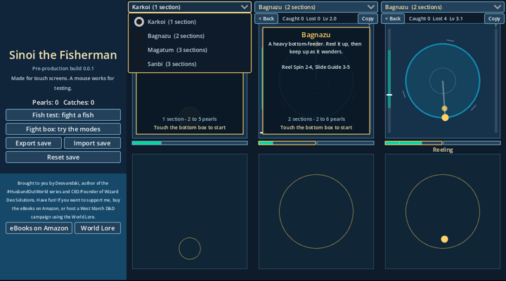

# 06 — Fish fights (sections)

Recorded November 22, 2026 from Deovandski's brief in [issue #16](https://github.com/Deovandski/Sinoi-the-fisherman/issues/16). **Status: prototype to playtest.** The fish and their numbers are placeholders; the structure (sections, a mode and a difficulty range each) is Deovandski's direction.

## The brief

- Replace the title screen's **Cast (placeholder)** with a screen, like the fight-box test, for testing every fish.
- Pick the fish from a **drop-down** of every fish in the game. **No difficulty slider**: difficulty is set per fish.
- Every fish has a **section bar** that fills in. Some fish have one section, others several. **Each section is a fight-box mode with a difficulty range.**
- On the fight-box test, swap the carousel for the same kind of drop-down and remove the "How hard?" boxes (the slider does that job).

## How a fish fight works

- The meter has one segment per section. The first segment starts a quarter full; the others start empty.
- Each section plays one fight-box mode ([chapter 04](04-fight-box-modes.md)). Filling the current segment moves on to the next section, which switches mode with a banner ("Section 2/3: Reel Spin").
- Filling the last segment **catches** the fish. If the current segment empties, the fish **gets away**, and the fight starts again from the first section.
- **Difficulty climbs inside a section:** it starts at the low end of the section's range and rises to the high end as the segment fills, so the fish fights harder as it tires. This is Claude's reading of "a difficulty range"; another reading is a random difficulty picked from the range when the section starts. To confirm with Deovandski.
- A catch adds the fish and a random reward from its pearl range to the save (what the old Cast button did), so the title screen's Pearls and Catches keep counting.

## The data

Every fish is in [`game/data/fish.json`](../../game/data/fish.json), easiest first:

```json
{
  "id": "magatum",
  "name": "Magatum",
  "based_on": "tuna (Japanese maguro + Portuguese atum)",
  "pearls": [3, 8],
  "description": "Fast and strong. Set the hook, survive its runs, then match its tail beat.",
  "sections": [
    {"mode": "flick_hookset", "difficulty": [0.3, 0.5]},
    {"mode": "reel_spin", "difficulty": [0.4, 0.6]},
    {"mode": "tap_tempo", "difficulty": [0.4, 0.6]}
  ]
}
```

- `mode` is a mode id from `fight_modes.json`; `difficulty` is `[from, to]` on the 0 (easy) to 1 (hard) scale, the same scale as the fight-box test's slider (shown there as 0–10).
- The mode's `[easy, hard]` tuning pairs are blended at the section's current difficulty, so tuning a mode once tunes it for every fish.

## The fish so far

All four existed before as the Cast button's placeholder catches. Their sections are a first pass, themed on the real fish they're named after.

| Fish | Based on | Sections (difficulty 0–10) | Pearls |
| --- | --- | --- | --- |
| Karkoi | carp (Karpfen + koi) | Slide Guide 1–3 | 2–5 |
| Bagnazu | catfish (bagre + namazu) | Reel Spin 2–4, Slide Guide 3–5 | 2–6 |
| Magatum | tuna (maguro + atum) | Hookset 3–5, Reel Spin 4–6, Tap Tempo 4–6 | 3–8 |
| Sanbi (canon) | #HusbandOutWorld | Hookset 5–7 (decoys), Hold Hop 5–7, Lost Ref 6–8 | 10–25 |

The "based on" pairs for Karkoi and Bagnazu are Claude's reading of the existing names under the two-language rule; Magatum's is the example in CLAUDE.md. Sanbi's fight is a placeholder until the lore is checked.

## The fish test screen



- **Title screen → Fish test: fight a fish.** A drop-down at the top lists every fish with its section count; under it, Back, the stats for that fish (catches, losses, average catch time, current difficulty) and **Copy**.
- The intro card shows the fish's description, its sections and their difficulty ranges, and its pearl range.
- Copy puts a results table on the clipboard:

```
Sinoi the Fisherman fish test, build 0.0.1, Android, screen 1080x2400, motion sensor yes
fish | sections | caught | lost | avg catch s | accuracy %
Magatum | Hookset 3-5, Reel Spin 4-6, Tap Tempo 4-6 | 1 | 3 | 41.2 | 57
```

- Results per fish are saved (`playtest.fish`, save format v4, see [SAVE_FORMAT.md](../SAVE_FORMAT.md)). **Reset save** clears them.

## Code

- `scripts/fight/fight_stage.gd` — the fight box shared by both test screens: pads, segmented meter, cue, intro card, banners, touch routing, sensor, sounds.
- `scripts/fight/fish_fight.gd` — sections, segment fills, the climbing difficulty, catch and escape.
- `scripts/fight/fish_catalog.gd` — reads `fish.json`.
- `scripts/fish_test.gd` + `scenes/fish_test.tscn` — the screen.
- `tests/test_fish_fights.gd` — data checks, section flow, difficulty climb, escape, and every fish's sections running.

## Open questions

- **Difficulty inside a section:** climbing from low to high (built) or a random pick from the range?
- **Meter between sections:** each new section starts a quarter full. Should a strong finish carry over, or a weak one carry a penalty?
- **Escape:** emptying any section loses the fish and restarts from section one. Should later sections be more forgiving (the fish is tired)?
- Fish beyond these four (canon Fihi, Ptaina, True Sanbi King, and new two-language fish) wait for the region and fish lists.
